<h1 align="center">4×4 Patch Array at 77 GHz on RT/duroid 5880</h1>

<p align="center">
  <em>openEMS full-wave study of a planar antenna array for automotive radar –
  from the Hammerstad first cut through impedance re-tuning to phased beam
  steering</em>
</p>

<p align="center">
  
  
  
  
</p>

<p align="center">
  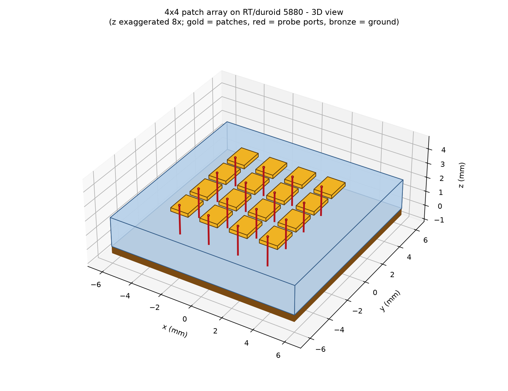
</p>

---

## Overview

This repository contains a fully script-driven openEMS study of a 4×4 patch
antenna array on **RT/duroid 5880** at **77 GHz**. The geometry exists in
exactly one place (`array_model.py`); projects, simulation runs, evaluations
and the ODT/PDF report are all derived from it. Four operating cases are
investigated:

| Project | Content |
|---|---|
| `patch_element_77ghz` | single element, production band 74–80 GHz |
| `patch_array_4x4_77ghz` | 4×4 array, only port P6 driven (embedded element, coupling) |
| `patch_array_4x4_broadside` | all 16 ports in phase |
| `patch_array_4x4_scan30` | all 16 ports, progressive phase, beam at +30° |

Four additional control and verification runs document the matching process
(open feed line, inset variation, two design candidates).

## Results at a glance

| Quantity | Element | Broadside | Scan +30° |
|---|---|---|---|
| Input impedance at 77 GHz | 53.8 + 14.5j Ω | – | – |
| Reflection \|S11\|(77) | −16.9 dB | – | – |
| −10 dB bandwidth | 74.06–79.10 GHz (5.04 GHz) | – | – |
| Directivity D<sub>max</sub> | 9.38 dBi | 17.91 dBi | 17.88 dBi |
| Efficiency η | 0.939 | 0.949 | 0.970 |
| Gain | 9.11 dBi | 17.69 dBi | 17.75 dBi |
| Beam direction | +z | θ = 2°, φ = 0° | θ = 28°, φ = 0° |
| Active reflection per port | – | −10.8 … −4.2 dB | −14.4 … −3.9 dB |

> **Note on the power budget:** the bundled openEMS post-processing takes the
> accepted power from the largest-amplitude port only. With 16 simultaneously
> driven ports this underestimates Pin by a factor of 16 and inflates η/gain by
> about 12 dB. The table lists the **corrected** values (sum over all 16 ports);
> directivity and patterns are pure field integrals and are unaffected. See
> [Evaluation notes](#evaluation-notes).

---

## 1. Antenna construction

### 1.1 Layout

Four elements in x and four in y, spacing d = λ<sub>0</sub>/2 = 1.947 mm,
board 12 × 12 mm. Each element has its own coaxial probe port from the ground
plane to the patch underside, so all 16 elements can be driven independently.

<p align="center">
  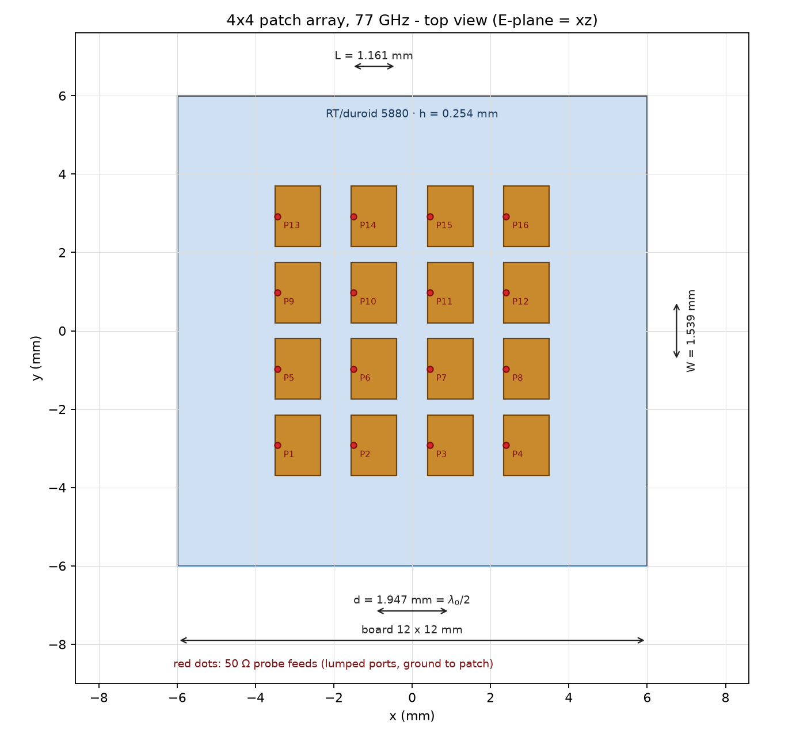
</p>

### 1.2 Element and feed

L = 1.161 mm (resonant in x), W = 1.539 mm. In the final design the probe
inset is only **0.058 mm** – about 5 % of the patch length. The right half of
the figure therefore shows a zoom on the feed; at full-patch scale the
difference would not be resolvable.

<p align="center">
  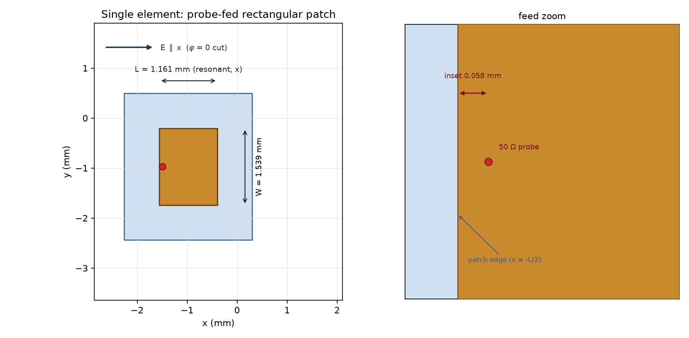
</p>

### 1.3 Stack-up

RT/duroid 5880 with ε<sub>r</sub> = 2.2, tan δ = 0.0009 and h = 0.254 mm
(10 mil); both copper layers modelled as 35 µm PEC sheets. The z axis is
exaggerated 6× in the cross-section.

<p align="center">
  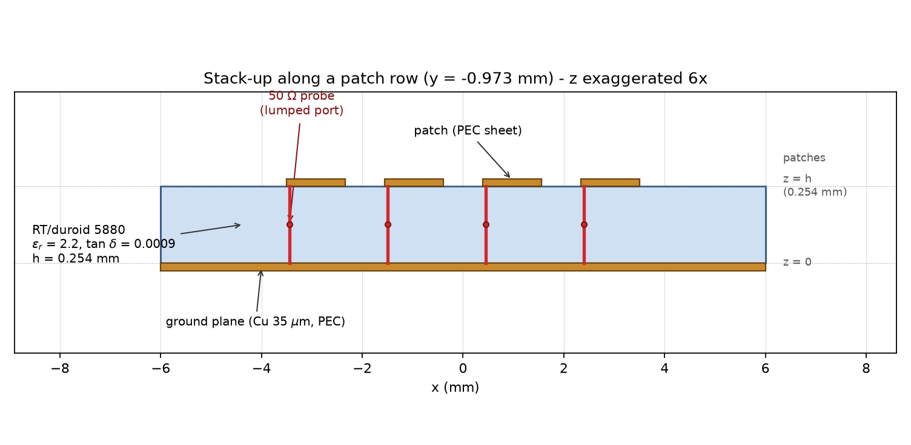
</p>

---

## 2. Matching the single element

The Hammerstad first cut (L = 1.1383 mm, inset 0.30 L = 0.341 mm) yields only
**14.8 + 68.0j Ω** and **−1.77 dB** at 77 GHz – a strongly inductive mismatch.
A control run with an open feed line and no patch shows that the probe itself
behaves as a short, open-ended line with **Z<sub>p</sub> = 188 Ω,
ε<sub>p</sub> = 3.40** (−205j Ω at 77 GHz), not as an inductance. After
de-embedding this line model, a local Newton iteration on the two design knobs
– patch length and inset – drives the impedance to 50 Ω.

<p align="center">
  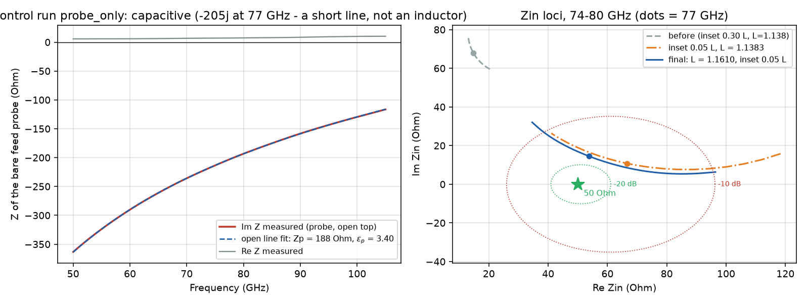
</p>

**Design chain** (simulated values at 77 GHz):

| Step | L (mm) | Inset | Z<sub>in</sub>(77) | \|S11\|(77) |
|---|---|---|---|---|
| Hammerstad first cut | 1.1383 | 0.30 L | 14.8 + 68.0j Ω | −1.8 dB |
| Inset control | 1.1383 | 0.05 L | 66.6 + 10.8j Ω | −15.4 dB |
| Candidate B | 1.1683 | 0.02 L | 38.7 + 20.7j Ω | −11.7 dB |
| **Candidate A – final** | **1.1610** | **0.05 L** | **53.8 + 14.5j Ω** | **−16.9 dB** |

The optimum is −17.4 dB at 76.58 GHz. More than about −17 dB is not reachable
with these two knobs at this substrate thickness: near the optimum the
impedance map is almost collinear, i.e. length and inset move the impedance in
the same direction.

<p align="center">
  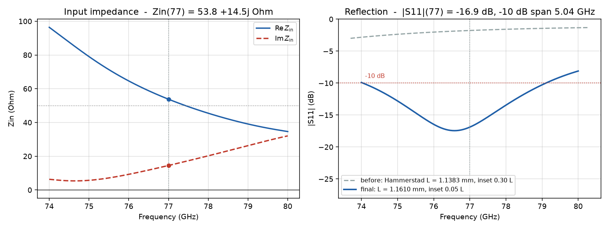
</p>

---

## 3. Radiation behaviour

### 3.1 Isolated element

Directivity 9.38 dBi, gain 9.11 dBi, efficiency 0.939. The beam points in +z
as expected and the E plane is the xz plane.

<p align="center">
  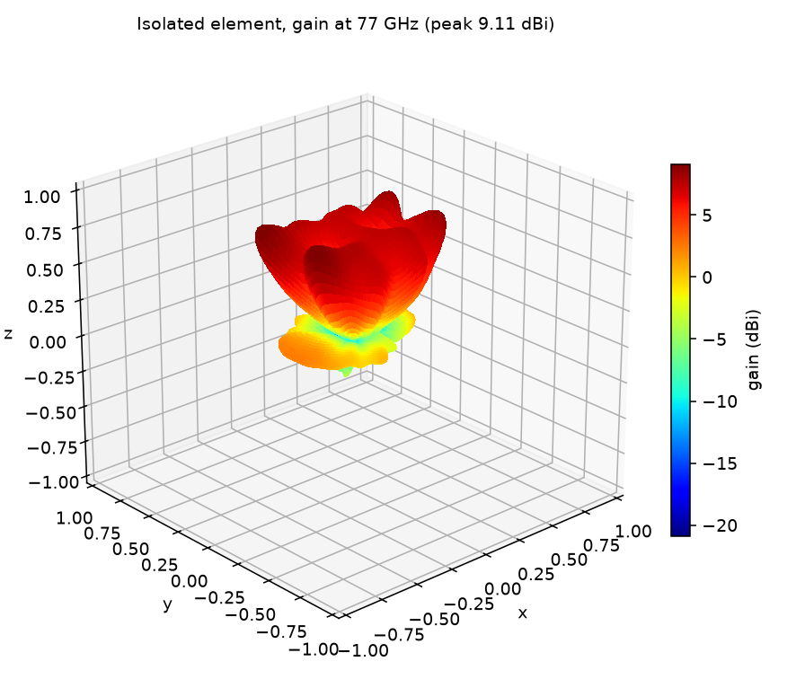
</p>

### 3.2 Embedded element and coupling

In the `embedded` run only port P6 is driven; all other ports are passively
terminated in 50 Ω. The self-reflection rises to **−18.0 dB**, the strongest
coupler is the direct neighbour in x at **−14.3 dB** and 1.95 mm distance; the
diagonal neighbours are around −25 dB and the edge elements below −28 dB. The
embedded element reaches 9.16 dBi at η = 0.814 – the difference to the
isolated element is the power handed to the neighbours, which is re-radiated
in the fully driven array.

<p align="center">
  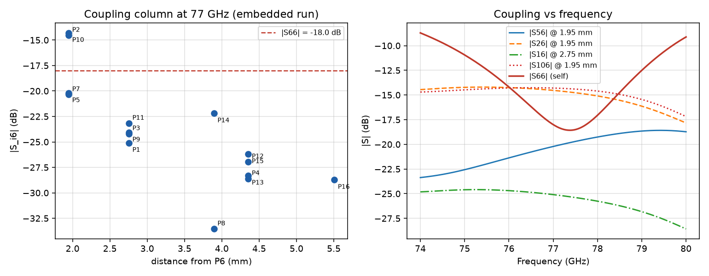
</p>

<p align="center">
  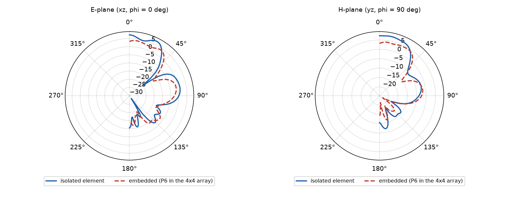
</p>

---

## 4. The 4×4 array

### 4.1 Broadside

All 16 ports driven in phase: **17.91 dBi** directivity. This agrees well with
the aperture estimate D ≈ 4πA/λ<sub>0</sub>² = 17.0 dBi for a uniformly excited
λ<sub>0</sub>/2 aperture; the 0.9 dB higher value follows from the element
pattern. The comparison with element × array factor agrees excellently down to
−20 dB – deviations in the nulls and wide sidelobes are the signature of the
neglected coupling and edge diffraction.

<p align="center">
  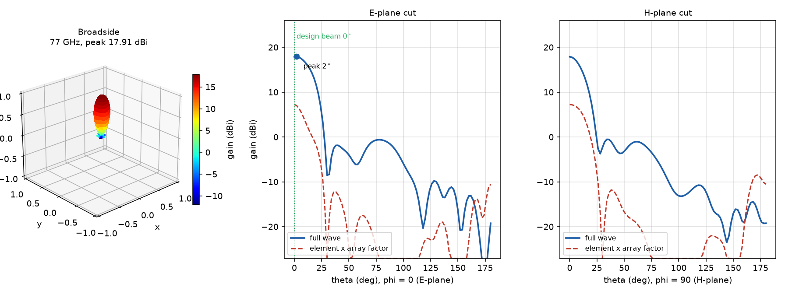
</p>

### 4.2 Beam steering by +30°

Progressive −90° per element in x (90° per spacing d = λ<sub>0</sub>/2). The
sign follows the openEMS phase convention (a wave travelling in +x carries
exp(−jkx), so the excitation must lead) and was verified with a test run: with
the opposite sign the beam appears mirrored at φ = 180°.

The maximum is at **θ = 28°, φ = 0°** with 17.75 dBi; the offset from the
nominal 30° results from the finite element beam and mutual coupling.

<p align="center">
  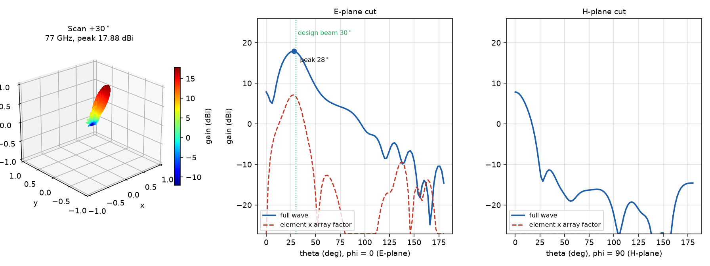
</p>

### 4.3 Comparison of both modes

Active reflection in the broadside case lies between −10.8 dB (ports 1/13) and
−4.2 dB (ports 4/8/12/16). In the steered case it improves by 3–6 dB for most
ports because the progressive phase partially cancels the coupling
contributions; the right-hand column at x = +2.4 mm remains conspicuous at
about −4 dB in both cases.

<p align="center">
  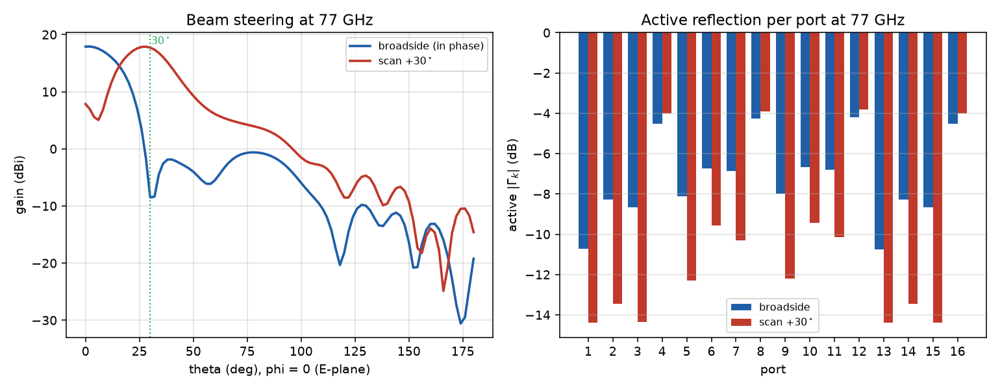
</p>

---

## 5. Near field

Frequency-domain snapshots at 77 GHz from the broadside run. In the E plane
the in-phase excitation of the four x-elements appears as a common wave front;
the top view 1.02 mm above the board shows the 4×4 aperture as a contiguous
source area.

<p align="center">
  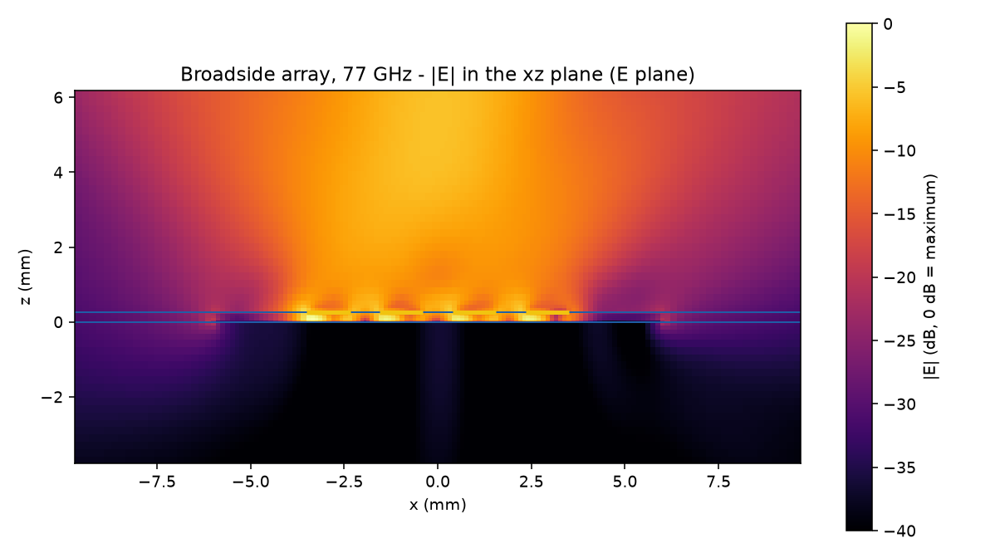
</p>

<p align="center">
  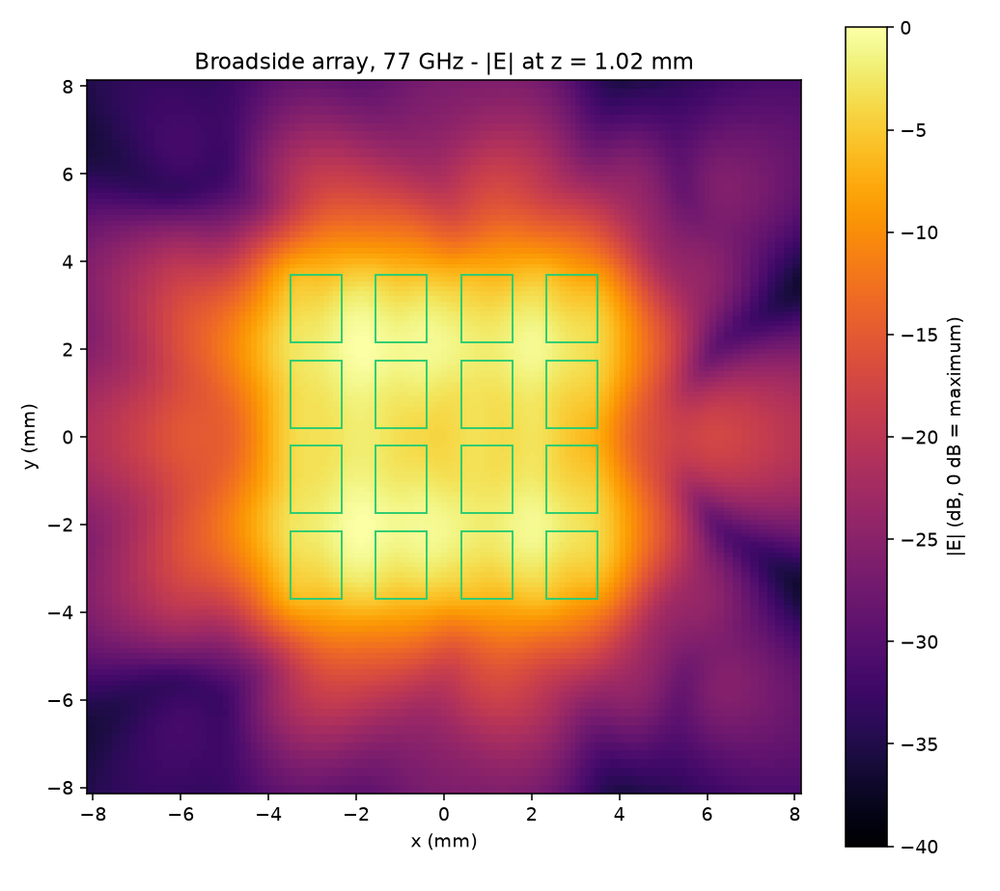
</p>

---

## 6. Discretisation and computational effort

Mesh preset "high" with explicit cell sizes: max 0.25 mm, refined edge
0.10 mm, min 0.07 mm, min z 0.06 mm. The 0.254 mm laminate is resolved by four
cells in z and the metal edges by about three cells. The FDTD run stops at
−40 dB residual energy.

| Run | Grid (cells) | Time steps | Wall time |
|---|---|---|---|
| Single element | 154×155×75 = 1,790,250 | 10,506 | approx. 20–30 min |
| Embedded element | 163×165×75 = 2,017,125 | 10,598 | approx. 20–30 min |
| Broadside array | 163×165×75 = 2,017,125 | 10,598 | approx. 20–30 min |
| Array +30° | 163×165×75 = 2,017,125 | 10,598 | approx. 20–30 min |

---

## 7. Reproduction

**Requirements:** Python 3.11 with numpy, matplotlib, h5py and Pillow, plus an
openEMS installation reachable through the VisualopenEMS project layer:

```powershell
$env:VISUALOPENEMS_ROOT = "C:\path\to\FreeCAD_OpenEMS_GUI"
```

**Full workflow:**

```powershell
python make_project.py --preview      # projects + construction figures 01..04
python validate_project.py            # mesh / collision checks
python run_headless.py patch_element_77ghz.fcsim.json
python run_headless.py patch_array_4x4_77ghz.fcsim.json
python run_headless.py patch_array_4x4_broadside.fcsim.json
python run_headless.py patch_array_4x4_scan30.fcsim.json
python plot_results.py                # figures 05..14 + docs/results.json
python build_docs.py                  # report DE + EN
```

Or everything at once (skips results that already exist):

```powershell
python run_all.py
```

---

## 8. Repository layout

```
array_model.py            single source of truth: geometry, ports, mesh, NF2FF box
make_project.py           writes the .fcsim.json projects + figures 01..04
validate_project.py       checks collisions, mesh rules, NF2FF box
run_headless.py           generates the openEMS script and runs it
plot_results.py           evaluates S-parameters and far fields (figures 05..14)
build_docs.py             builds the German and English ODT reports
run_all.py                end-to-end runner with skip logic
analyze_zin.py            quick Zin(f) evaluation
fit_model.py              probe line model + Newton re-tuning
make_candidate.py         creates candidate projects
analyze_controls.py       compares the control runs
make_controls.py          creates control projects (probe_only, inset005)
make_wideband.py          wideband reference run
*.fcsim.json              the projects (production + controls)
work_*/                   simulation output (not versioned)
docs/figures/             figures 01..14
docs/results.json         numeric source for the report
docs/*.odt                report in German and English
```

---

## 9. Documentation

| File | Content |
|---|---|
| [`docs/patch_array_4x4_77ghz_de.odt`](docs/patch_array_4x4_77ghz_de.odt) | 15-page report in German, 14 figures, 4 tables |
| [`docs/patch_array_4x4_77ghz_en.odt`](docs/patch_array_4x4_77ghz_en.odt) | English edition |
| [`docs/results.json`](docs/results.json) | all key figures as JSON |

## Evaluation notes

* **Efficiency/gain of the 16-port runs.** The bundled openEMS post-processing
  uses only the largest-amplitude port (`postproc.nf2ff._load_pin_spectral`).
  With 16 simultaneously driven ports Pin is ~16× too small, so η and gain are
  ~12 dB too high. `plot_results.py` sums the accepted power over all ports;
  directivity and patterns are unaffected.
* **Port signal time axes.** openEMS stores voltage and current on slightly
  offset time grids (≈0.03–0.04 dt). Transforming both signals on their own
  axes introduces an apparent phase shift and an error in the real power of up
  to 11 %. The evaluation therefore uses the same time axis for both signals,
  as the openEMS post-processing does.
* **Phase sign.** "+30°" means a beam towards +x (φ = 0°). The convention was
  verified with a test run.

## Accuracy and limitations

* Numerical uncertainty of the directivity is about ±0.2 dB.
* The array-factor comparison ignores coupling and edge diffraction – it
  describes the pattern well, the beam direction only approximately.
* Probe matching with two knobs is limited to about −17 dB.
* The right-hand array edge shows an active reflection of only about −4 dB; a
  real module would need feed matching there.

---

<p align="center"><sub>VisualopenEMS · openEMS 2026</sub></p>
